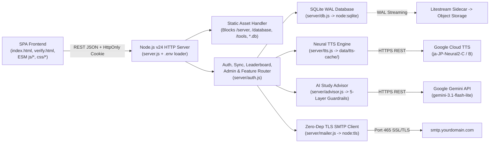

# Senjuku (せんじゅく) — Senjuku Nihongo (せんじゅく日本語)
### Japanese Reading Gym & Kana-Writing Web Application

An interactive Japanese reading, vocabulary, and Kana-writing web application aligned 1:1 with *Minna no Nihongo I* (**Bab 1–25**, Audio Tracks **001–087**), built with a zero-external-npm Node.js v24 backend, vanilla ECMAScript modules, SQLite WAL mode, and the **Sumi & Urushi** editorial design system.

> 📖 **Comprehensive Solution Documentation**: For detailed functional specifications, SRS formulas, randomization algorithms, scoring rules, and database schemas, refer to [`docs/SOLUTION_DOCUMENTATION.md`](docs/SOLUTION_DOCUMENTATION.md).

---

## 🏗️ Solution Architecture

Senjuku is engineered as a lightweight, zero-dependency SPA + REST architecture designed for desktop and mobile browsers, deployable as a container on Cloud Run with Litestream continuous replication.



### Architectural Highlights

| Layer | Responsibility | Key Technologies |
|---|---|---|
| **Core Runtime** | Zero-dependency HTTP routing, static asset serving, path-traversal guards, security headers. | Native `node:http`, Node.js v24+ |
| **Persistence** | Multi-user progress sync, SRS review tracking, AI advisor cache & quota, activity logging, admin analytics. | Native `node:sqlite` (`DatabaseSync`), WAL mode |
| **Authentication & RBAC** | Salted `scrypt` hashing, session cookies (`kk_session`), brute-force lockout, single-use token verification, Student/Admin roles. | Native `node:crypto` |
| **Neural TTS** | Tokyo Japanese speech synthesis with permanent SHA-256 disk cache and browser voice fallback. | Google Cloud TTS Neural2 (`ja-JP-Neural2-C/B`) |
| **AI Study Advisor** | One-shot analytical coaching bullets based on aggregated user timing and mistake history (zero free-text chat). | Google Gemini API (`gemini-3.1-flash-lite`), 5-layer guardrails |
| **Transactional Email** | Account activation, password reset, lesson clear, and grade unlock milestone notifications. | Native `node:tls` SMTP client (Port 465 SSL/TLS) |
| **UI Design System** | Modern dual-theme editorial canvas with mobile ergonomics (`<= 640px`) and tabular numerics. | **Sumi & Urushi** CSS (`css/sumi-urushi.css`) |

---

## 🎯 Core Features

1. **Bite-Sized 8-Question Drill Sessions (`SESSION_BYTE_SIZE = 8`)**:
   - **Tebak Bacaan (MCQ)**: 4-option reading recognition with unbiased Fisher-Yates answer slot shuffling.
   - **Tebak Bacaan (Ketik)**: Kana writing enforced via the built-in Japanese Kana On-Screen Keyboard.
   - **Vocab Booster (Kana & Kanji)**: 3-pair drag-and-drop / click-swap matching with strict derangement shuffling.
   - **Ketik Kalimat Penuh**: Full-sentence Kana transcription from native audio.
   - **Kalimat Rumpang (Cloze)**: Context-rich fill-in-the-blank grammar and particle drills with SVG visuals.
   - **Perbaiki Skor Saya**: Targeted repetition of weak cards failed within the past 7 days.

2. **Session Scoring & Early Exit Penalization**:
   - Explicit numerical scoring (`X / 100`) and correct count (`X / Y Soal Benar`).
   - Premature exits penalize all remaining unanswered questions as wrong, demoting cards in the SRS Leitner box.

3. **Audio Transcripts & Tokyo Neural2 TTS**:
   - Complete *Minna no Nihongo I* transcripts (Bab 1–25, Tracks 001–087).
   - 3 Furigana display modes (*Tampilkan Semua*, *Hover to Reveal*, *Tanpa Furigana*).
   - High-fidelity Google Cloud Neural2 speech synthesis with permanent disk caching (`data/tts-cache/`).

4. **Kana Writing Companion (`書 Tulis Kana`)**:
   - All 46 Hiragana and 46 Katakana characters with KanjiVG animated stroke orders, step-by-step guides, mnemonics, and printable workbook mode (`Klee One` font).

5. **Progression & Gamification**:
   - 5-Grade gradual block unlock system (Bab 1–5 &rarr; 6–10 &rarr; 11–15 &rarr; 16–20 &rarr; 21–25).
   - Transparent Bab question-bank coverage score (`score / 100`, or `100 🏆` upon mastery).
   - Privacy-safe public Leaderboard and Sensei Admin Dashboard.

---

## 🚀 Quick Installation

### Prerequisites
- **Node.js v24.0.0+** (uses native `node:sqlite`, zero external npm packages needed).
- Or **Docker** (no local Node.js installation required).

### Option 1: Local Machine
```bash
git clone https://github.com/agralabs/senjuku.git
cd senjuku
cp .env.example .env
node server.js
```
Open **http://localhost:3000**.

### Option 2: Docker (Quick Container)
```bash
git clone https://github.com/agralabs/senjuku.git
cd senjuku
cp .env.example .env
docker build -t senjuku-nihongo .
docker run -d --name senjuku-nihongo --restart unless-stopped \
  -p 3000:3000 --env-file .env -e PORT=3000 -e DB_PATH=/data/senjuku.db \
  -v senjuku_data:/data senjuku-nihongo node server.js
```

### Option 3: Linux VM (Ubuntu / Debian)
```bash
curl -fsSL https://deb.nodesource.com/setup_24.x | sudo -E bash -
sudo apt-get install -y nodejs git
git clone https://github.com/agralabs/senjuku.git /opt/senjuku-nihongo
cd /opt/senjuku-nihongo
cp .env.example .env   # Configure BASE_URL, ADMIN_DEFAULT_*, SMTP_*
node server.js         # Or run via systemd + Caddy (see Solution Documentation)
```

### Default Admin Login (Fresh Install)
On a fresh SQLite database, `server/admin-bootstrap.js` automatically creates an active Admin (**Sensei**) account without requiring SMTP:
- **Email / Nickname**: `admin@senjuku.local` / `SenseiAdmin`
- **Default Password**: `AdminSenjuku123!` *(override via `ADMIN_DEFAULT_PASSWORD` in `.env`, or change immediately in **Profil → Ubah Kata Sandi** on first login)*.

> 📖 For full **GCP Cloud Run (Litestream + GCS)**, **Docker**, and **VM (systemd + Caddy HTTPS + automated backups)** guides, see [`docs/SOLUTION_DOCUMENTATION.md`](docs/SOLUTION_DOCUMENTATION.md#3-deployment-guide).

---

## 📂 Project Structure

```
senjuku/
├── index.html                   # Main single-page application entry
├── verify.html                  # Email verification & password reset page
├── server.js                    # Zero-dependency Node.js v24 HTTP server
├── style.css                    # Base layout & components stylesheet
├── package.json                 # Project metadata & test scripts
├── Dockerfile                   # Multi-stage production container
├── litestream.yml               # Litestream SQLite replication config
├── .env.example                 # Environment template
│
├── css/
│   ├── sumi-urushi.css          # Sumi & Urushi unified editorial design system
│   ├── auth-leaderboard.css     # Auth modal, profile & leaderboard styles
│   ├── kana-companion.css       # Kana stroke workbook & canvas styles
│   └── ai-advisor.css           # AI Study Advisor report card styles
│
├── server/
│   ├── auth.js                  # Authentication router, RBAC & API endpoints
│   ├── db.js                    # Native SQLite database layer & migrations
│   ├── advisor.js               # Gemini AI Study Advisor & guardrails
│   ├── tts.js                   # Neural TTS synthesizer & disk cache
│   └── mailer.js                # TLS SMTP client for transactional emails
│
├── data/
│   ├── book-mapping.js          # Minna no Nihongo I Bab 1–25 audio mapping
│   ├── lessons-*.js             # Transcripts & dialogues (Bab 1–25)
│   ├── kanji-vocabulary.js      # Kanji vocabulary master bank
│   ├── cloze-sentences.js       # Cloze fill-in-the-blank question bank
│   ├── vocab-booster.js         # 3-pair vocabulary matching bank
│   ├── sentence-romaji.js       # Full-sentence typing bank
│   └── kana-writing-data.js     # 92 Hiragana/Katakana stroke data (KanjiVG)
│
├── js/
│   ├── app.js                   # Main application orchestrator & event bus
│   ├── drills.js                # Drill engine, timers, shuffle & score logic
│   ├── srs.js                   # Leitner box spaced repetition engine
│   ├── audio.js                 # Neural2 & browser audio playback engine
│   ├── kana-keyboard.js         # Japanese Kana on-screen virtual keyboard
│   ├── kana-companion.js        # Kana writing workbook & stroke animator
│   ├── explorer.js              # Audio transcript viewer & shadowing
│   ├── scorecard.js             # SVG progress charts & coverage calculators
│   ├── ai-advisor.js            # AI Study Advisor UI integration
│   ├── progression.js           # Grade block unlock & celebration modals
│   ├── weakness.js              # Mistake focus (Perbaiki Skor Saya)
│   └── auth-ui.js               # Auth modals, leaderboard & admin panel
│
├── docs/
│   └── SOLUTION_DOCUMENTATION.md # Comprehensive functional & technical specification
│
└── tools/
    ├── manage-user.cjs          # Admin CLI tool (list, activate, set-admin)
    ├── verify-answer-randomization.mjs # 2,000-iteration statistical test suite
    ├── verify-early-exit-and-scores.mjs # Scoring & early exit verification
    └── verify-*.mjs             # Zero-dependency automated test suites
```

---

## 🧪 Verification & Automated Tests

All test suites run natively using Node.js without third-party test runners:

```bash
# Verify session scoring & early exit penalization
node tools/verify-early-exit-and-scores.mjs

# Verify 2,000-iteration statistical answer & question randomization
node tools/verify-answer-randomization.mjs

# Verify multi-user authentication, tokens & security
node tools/verify-multiuser-auth.mjs

# Verify AI Study Advisor guardrails & quota
node tools/verify-ai-advisor.mjs
```

---

## 📄 License

This project is licensed under the MIT License.
