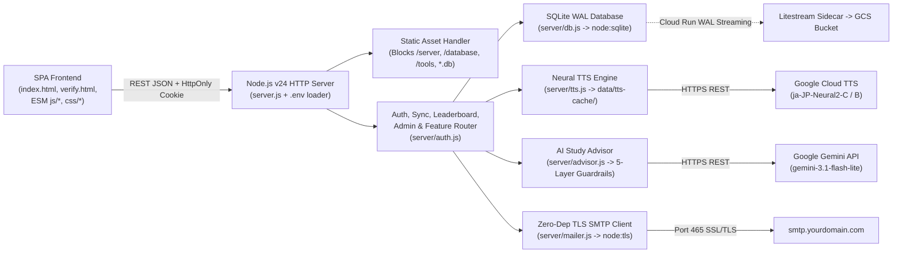

# KiraKira Nihongo (きらきら日本語) — Complete Solution Documentation

**Version:** 2.5 (Minna no Nihongo I — Bab 1–25, Kana Writing Companion, Google Cloud Neural2 TTS, Gemini AI Study Advisor, Sumi & Urushi Web + Mobile UI, Multi-User RBAC, SQLite + Litestream)  
**Runtime:** Node.js v24+ (Zero External npm Dependencies — Native `node:http`, `node:sqlite`, `node:crypto`, `node:tls`, `fetch`)

---

## 1. Application Functionality

**KiraKira Nihongo Reading Gym** is an interactive Japanese reading & Kana-writing web application aligned 1:1 with *Minna no Nihongo I* (**Bab 1–25**, Audio Tracks **001–087**), engineered as a single responsive web app for desktop and mobile browsers.

### 1.1 Access Control & Multi-User Accounts
- **Registered Users Only (Auth Gate)**: Anonymous browsing is blocked both in the UI (`body.auth-gate-locked`) and on the API (`/api/leaderboard`, `/api/progress/*`, `/api/profile`, `/api/achievements/*`, `/api/tts*`, `/api/activity/*`, `/api/advisor/*`, `/api/admin/*` return `401 Unauthorized` without a valid session cookie).
- **Email-Link Registration**: Users register with **Nickname + Email** only. A single-use 24-hour verification link is emailed via TLS SMTP (`smtp.yourdomain.com:465`). Clicking the link opens `verify.html` to set a password and immediately activates & signs in the account.
- **Forgot Password**: Clicking **Lupa kata sandi?** in the Login modal sends a 24-hour single-use reset link (`verify.html?token=...&mode=reset`) and clears any active login lockout upon password reset.
- **Roles (RBAC)**:
  - **`student`** *(default)*: Full access to Daily Drill, Tulis Kana, Audio Transcript, My Progress (Scorecard + AI Advisor), Perbaiki Skor Saya, Profile/Membership, and privacy-safe Papan Peringkat.
  - **`admin`** *(Sensei / Guru)*: Everything `student` has, plus the **`教 Dashboard Sensei`** tab (class overview analytics, hardest cards across all students, per-student mistake reports, resend verification email, manual account activation, enable/disable accounts, role management).
- **Membership Tiers**: `free` and `pro` (editable in the Profile & Membership modal, badge shown in header & Leaderboard).

### 1.2 Drill Modes (Quiz Mode vs. Learning Mode)
Each drill session draws a **bite-sized byte of 8 questions** (`SESSION_BYTE_SIZE = 8`) from selected lessons across Bab 1–25 (presets: `Semua`, `1-5`, `6-10`, `11-15`, `16-20`, `21-25`, `Reset`):

| Mode | Format | Quiz Mode Timer | Learning Mode Timer | Audio Limit |
|---|---|---:|---:|---|
| **Tebak Bacaan (MCQ)** | 4-option reading recognition | **25 s / Q** | No limit (Flashcard) | Quiz: **3× manual**<br>Learning: **5× manual** (autoplay exempt) |
| **Tebak Bacaan (Ketik)** | Kana writing via **Japanese Kana On-Screen Keyboard** (no Romaji auto-convert) | **25 s / Q** | **25 s / Q** | Quiz: **3× manual**<br>Learning: **5× manual** |
| **Vocab Booster: Kana** | 3 Indonesian ↔ 3 Kana pairing (click-swap, ▲/▼, drag-and-drop; 1-shot all-or-nothing) | **25 s / Q** | No limit | Learning: **5× manual** |
| **Vocab Booster: Kanji** | 3 Indonesian ↔ 3 Kanji pairing (1-shot all-or-nothing) | **25 s / Q** | No limit | Learning: **5× manual** |
| **Ketik Kalimat Penuh** | Full-sentence Kana writing from audio transcripts via Kana On-Screen Keyboard | **45 s / Q** | **45 s / Q** | Quiz: **3× manual**<br>Learning: **5× manual** |
| **Kalimat Rumpang (Cloze)** | Fill-in-the-blank Kana/Kanji only + SVG context visual (2× highest weight, mandatory 100%) | **25 s / Q** | No limit | Quiz: **3× manual**<br>Learning: **5× manual** |
| **Perbaiki Skor Saya** | Targeted repetition of mistakes made in the last 7 days | **25 s / Q** | No limit | Quiz: **3× manual**<br>Learning: **5× manual** |
| **Spesial Katakana** | Loanword Katakana reading blitz | **25 s / Q** | No limit | Quiz: **3× manual**<br>Learning: **5× manual** |

### 1.2.1 Bite-Sized Byte Generation & Unbiased Randomization (`js/drills.js`)
- **Question Presentation Order Randomization (`buildByteQueue`)**:
  - Pulls candidate questions prioritizing uncovered items first (`coverageCredit === 0`), followed by learning-only items (`0 < credit < 1.0`), then spaced-repetition due review cards.
  - Slices a bite-sized byte of exactly 8 questions (`SESSION_BYTE_SIZE = 8`), then executes an unbiased **Fisher-Yates shuffle** on the final 8-question byte queue so new cards, learning cards, and review cards are interleaved uniformly without predictable sequencing.
- **Answer Appearance Randomization**:
  - **4-Option MCQ & Kalimat Rumpang (Cloze)**: The correct answer and 3 dynamically drawn distractors are shuffled using an unbiased Fisher-Yates algorithm, ensuring the correct answer appears uniformly across all 4 button positions (A, B, C, D / slots 0..3) with no bias toward any specific position.
  - **Vocab Booster 3-Pair Matching (Kana & Kanji)**: The right-hand column options are shuffled using a **strict derangement shuffle** (`shuffled[i].id !== left[i].id` for all \(i \in \{0, 1, 2\}\)), guaranteeing that zero cards start pre-aligned in their matching row at question load time.

### 1.2.2 Session Scoring, Completion Modal & Early Exit Penalization (`js/drills.js`, `js/app.js`)
- **Explicit Numerical Score & Question Count Display (`#sessionCompleteModal`)**:
  - **Jawaban Benar**: Explicitly displays how many questions were answered correctly out of the session total (e.g., **`8 / 8 Soal Benar`** or **`6 / 8 Soal Benar`**), eliminating ambiguous passive terminology.
  - **Skor Sesi**: Prominently presents a scaled numerical score (**`Skor: X / 100`**) with dynamic semantic color-coding:
    - **Emerald Green** (`highlight-green`): Score \(\ge 80\) (Passing / Full Target).
    - **Amber Gold** (`highlight-gold`): Score \(50 \le \text{Score} < 80\) (Satisfactory).
    - **Urushi Red** (`highlight-red`): Score \(< 50\) (Needs Improvement).
  - **Learning Mode Transparency**: Explicitly indicates that Learning Mode contributes 10% coverage weight relative to Quiz Mode (**`100 / 100 (Bobot 10% Belajar)`**).
  - **Cakupan Bank Soal Bab**: Displays the total calculated coverage score achieved so far (**`score / 100`**, or `100 🏆` upon full mastery) directly beside each Bab progress bar, intentionally omitting redundant raw decimal percentages to keep student feedback clean, focused, and immediately actionable.
- **Early Exit Penalization (Unanswered = Wrong)**:
  - If a student finishes or exits a session prematurely (via the `#finishDrillBtn` "Akhiri sesi sekarang" button or timer expiration) before completing all 8 questions:
    1. **Unanswered Question Detection**: `unanswered = Math.max(0, totalByte - cardsReviewed)`.
    2. **Automatic Failure Attribution**: `this.wrongCount += unanswered`.
    3. **SRS Leitner Box Demotion**: In Quiz Mode, every remaining unanswered card is immediately recorded as failed in the SRS engine via `progress.recordCardReview(card.id, false)`, demoting its Leitner stage, resetting streak to 0, logging a mistake timestamp, and scheduling it for immediate repeat. This strictly prevents students from dodging difficult questions.
    4. **Full-Byte Score Scaling**: The session score is calculated against the full 8 questions: `Math.round((correctCount / totalByte) * 100)`. For example, answering 2 correctly out of 8 yields a score of **`25 / 100`** (not 100% or 67%).
    5. **Completion Bonus Forfeiture**: Session completion bonus XP (`15 XP` / `50 XP`) is forfeited if `unanswered > 0`.
    6. **Transparent UI Reporting**: The completion modal displays clear feedback: e.g., **`2 / 8 Soal Benar`** with annotation `(6 belum dijawab = salah)`.
  - Confirmation prompt on early exit explicitly warns the user: *"Akhiri sesi sekarang? Soal yang belum dijawab akan dihitung sebagai salah."*

### 1.2.3 Availability & Visual Appearance of Romaji & Translation (Arti) in Quiz Mode vs. Learning Mode
Reading aids are controlled globally via header toggle buttons (`#headerToggleRomajiBtn`, `#headerToggleTransBtn`), in-drill HUD pills (`#drillHudToggleRomajiBtn`, `#drillHudToggleTransBtn`), and keyboard shortcuts (**`M`** for Romaji, **`T`** for Arti/Translation). Settings persist in `localStorage('kirakira_reading_prefs')` and toggle CSS classes `body.hide-romaji` and `body.hide-translation` on `document.body` (causing matched `.disp-romaji` and `.disp-translation` elements to instantly switch `display: none !important`).

To ensure pedagogical rigor (preventing cognitive crutches during active testing while providing rich, multi-layered scaffolding during learning and review), the system strictly distinguishes **how** and **where** these aids visually appear between **Quiz Mode** and **Learning Mode**:

#### A. How Reading Aids Appear in Quiz Mode (Mode Kuis)
- **Active Question State (During Countdown)**:
  - **Romaji Appearance**: **Strictly Excluded & Hidden**. In MCQ reading drills, the 4 option buttons (1–4 / A–D) render authentic Kana only (`<span class="opt-text">${opt}</span>`). Romaji never renders in the question prompt or option cards, ensuring students cannot lean on Latin letters. In Typing drills, Romaji is completely blocked from the input field (Kana On-Screen Keyboard is enforced). In Cloze and Full-Sentence Typing, Romaji is suppressed entirely during the question timer.
  - **Translation (Arti) Appearance**: In Kanji reading and word typing, the Indonesian translation of the *context sentence* (`<p class="drill-sentence-id disp-translation">"${card.sentenceId}"</p>`) appears as an italicized quote below the Japanese sentence to clarify sentence context. Pressing **`T`** (or clicking the HUD/Header toggle) instantly shows or hides this quote. In Cloze and Full-Sentence Typing, sentence translation is completely hidden during the active question countdown to test genuine contextual comprehension.
- **Feedback Drawer State (After Submitting Answer or Timeout)**:
  - An animated drawer slides open below the drill card:
    - **Romaji**: Appears in parentheses immediately adjacent to the emerald/ruby reading badge: `<span class="badge-reading">${card.kana}</span> <span class="quiz-romaji disp-romaji">(${card.romaji})</span>`. Shows or hides dynamically with the Romaji toggle (**`M`**).
    - **Translation (Arti)**: Appears on a dedicated row: `<p class="quiz-meaning-row disp-translation"><strong>Arti:</strong> ${card.meaningId}</p>`. Shows or hides dynamically with the Translation toggle (**`T`**).

#### B. How Reading Aids Appear in Learning Mode (Mode Belajar)
Learning Mode is engineered as an instructional study guide rather than an exam, making rich reading and translation scaffolding readily accessible across distinct interactive components:
- **Flashcard Format (Tebak Bacaan Belajar)**:
  - **Front Face**: Displays only the large target Kanji (`.large-kanji.flashcard-kanji-target`) and an instruction hint: *"💡 Klik kartu atau tekan Spasi untuk melihat bacaan & arti"*. Romaji and Translation are intentionally absent from the front face to encourage initial active memory recall.
  - **Back Face (Flipped on Card Click or Spacebar)**:
    - **Romaji**: Displayed prominently in parentheses right beside the large Kana reading: `<span class="flashcard-kana">${card.kana}</span> <span class="flashcard-romaji disp-romaji">(${card.romaji})</span>`. Controlled by the Romaji toggle (**`M`**).
    - **Translation (Arti)**: Displayed in two dedicated locations:
      1. Meaning line: `<div class="flashcard-meaning-row disp-translation"><span class="flashcard-meaning-label">Arti:</span> <span class="flashcard-meaning-text">${card.meaningId}</span></div>`.
      2. Context sentence quote: `<p class="fc-sentence-id disp-translation">"${card.sentenceId}"</p>`. Controlled by the Translation toggle (**`T`**).
- **Word Typing Learning Format**:
  - Positions an explicit **Learning Hints Bar (`.learning-hints-bar`)** right between the target Kanji and the context sentence box:
    - **Romaji Hint**: `<span class="learning-hint-item disp-romaji">Bacaan: <strong class="hint-kana">${card.kana}</strong> <span class="hint-romaji">(${card.romaji})</span></span>`.
    - **Translation Hint**: `<span class="learning-hint-item disp-translation">Arti: <strong class="hint-meaning">${card.meaningId}</strong></span>`.
    - Both hints can be toggled on/off independently via **`M`** and **`T`** without leaving the keyboard.
- **Full-Sentence Typing Learning Format (`sentence_romaji`)**:
  - Features an instructional **Sentence Learning Hints Box (`.sentence-romaji-learning-hints`)** above the input area:
    - **Romaji**: `<span class="learning-hint-item disp-romaji"><strong>Romaji:</strong> ${card.romaji}</span>`.
    - **Translation**: `<span class="learning-hint-item disp-translation"><strong>Arti:</strong> ${card.translation}</span>`.
    - Also includes an interactive `"👁️ Lihat Kunci Kana"` button allowing learners to preview the Kana character sequence prior to submission.
- **Vocab Booster 3-Pair Matching Learning Format**:
  - **Right-Hand Cards (Kanji Mode)**: Displays a subtle Kana reading sub-pill (`<span class="vb-kana-hint disp-romaji">${right.kana}</span>`) directly below each Kanji character. Controlled by the Romaji toggle (**`M`**).
  - **Pronunciation Audio**: An individual audio speaker button (`🔊`) is attached to each card row for on-demand playback.
  - **Left-Hand Cards**: Always displays the Indonesian meaning (`.vb-meaning-text`). Because this meaning represents the matching puzzle's question prompt itself, it remains permanently visible and is not suppressed by the translation toggle.

#### C. Simple Matrix: Availability (ON / OFF) of Romaji & Translation by Part & Mode

| Tipe Soal (Question Type) | Bagian / Komponen (Part) | Mode Kuis: Romaji | Mode Kuis: Arti | Mode Belajar: Romaji | Mode Belajar: Arti | Penjelasan Tampilan & Shortcut |
|---|---|:---:|:---:|:---:|:---:|---|
| **1. Tebak Bacaan (MCQ)** | **Pilihan Jawaban (Opsi 1–4)** | ❌ **OFF** | ❌ **OFF** | *N/A (Flashcard)* | *N/A (Flashcard)* | Opsi tombol kuis hanya berisi Kana murni (`opt-text`) |
| | **Kalimat Contoh Soal** | ❌ **OFF** | ✅ **ON (`T`)** | *N/A (Flashcard)* | *N/A (Flashcard)* | Terjemahan kalimat konteks sebagai kutipan (`T`) |
| | **Flashcard: Sisi Depan** | *N/A (Opsi MCQ)* | *N/A (Opsi MCQ)* | ❌ **OFF** | ❌ **OFF** | Hanya Kanji target besar untuk memicu *active recall* |
| | **Flashcard: Sisi Belakang** | *N/A (Opsi MCQ)* | *N/A (Opsi MCQ)* | ✅ **ON (`M`)** | ✅ **ON (`T`)** | Muncul setelah klik/spasi: `kana (romaji)` & baris arti |
| | **Laci Pembahasan (Feedback)** | ✅ **ON (`M`)** | ✅ **ON (`T`)** | *N/A (Flashcard)* | *N/A (Flashcard)* | Lencana bacaan + `(romaji)` dan baris arti terjemahan |
| **2. Tebak Bacaan (Ketik)** | **Kotak Input Jawaban** | ❌ **OFF** | ❌ **OFF** | ❌ **OFF** | ❌ **OFF** | Wajib Keyboard Kana (input Romaji ditolak sistem) |
| | **Hint Bar Pembelajaran** | ❌ **OFF** | ❌ **OFF** | ✅ **ON (`M`)** | ✅ **ON (`T`)** | `.learning-hints-bar` di atas input: `Kana (Romaji)` & Arti |
| | **Kalimat Contoh Soal** | ❌ **OFF** | ✅ **ON (`T`)** | ❌ **OFF** | ✅ **ON (`T`)** | Terjemahan konteks di bawah kalimat Jepang (`T`) |
| | **Laci Pembahasan (Feedback)** | ✅ **ON (`M`)** | ✅ **ON (`T`)** | ✅ **ON (`M`)** | ✅ **ON (`T`)** | Kunci bacaan Kana + Romaji dan arti kata |
| **3. Vocab Booster (Kana)** | **Kartu Kiri (Makna)** | ❌ **OFF** | 🔒 **ON (Tetap)** | ❌ **OFF** | 🔒 **ON (Tetap)** | Makna Indonesia = prompt soal (selalu tampil) |
| | **Kartu Kanan (Kana)** | ❌ **OFF** | ❌ **OFF** | ❌ **OFF** | ❌ **OFF** | Tombol pasangan hanya menampilkan Kana |
| **4. Vocab Booster (Kanji)**| **Kartu Kiri (Makna)** | ❌ **OFF** | 🔒 **ON (Tetap)** | ❌ **OFF** | 🔒 **ON (Tetap)** | Makna Indonesia = prompt soal (selalu tampil) |
| | **Kartu Kanan (Kanji)** | ❌ **OFF** | ❌ **OFF** | ✅ **ON (`M`)** | ❌ **OFF** | Sub-pill Kana (`.vb-kana-hint`) di bawah Kanji + audio `🔊` |
| **5. Ketik Kalimat Penuh** | **Saat Mengetik (Timer)** | ❌ **OFF** | ❌ **OFF** | ✅ **ON (`M`)** | ✅ **ON (`T`)** | Kuis: disembunyikan. Belajar: kotak hint + *"Lihat Kunci"* |
| | **Laci Pembahasan (Feedback)** | ✅ **ON (`M`)** | ✅ **ON (`T`)** | ✅ **ON (`M`)** | ✅ **ON (`T`)** | Transkrip Romaji dan arti kalimat lengkap |
| **6. Kalimat Rumpang (Cloze)**| **Saat Soal Aktif** | ❌ **OFF** | ❌ **OFF** | ❌ **OFF** | ✅ **ON (`T`)** | Kuis: tanpa terjemahan. Belajar: terjemahan kalimat aktif (`T`) |
| | **Laci Pembahasan (Feedback)** | ✅ **ON (`M`)** | ✅ **ON (`T`)** | ✅ **ON (`M`)** | ✅ **ON (`T`)** | Kalimat utuh + bacaan Romaji & terjemahan Indonesia |
| **7. Audio Transcript** | **Gelembung Dialog** | ✅ **ON (`M`)** | ✅ **ON (`T`)** | ✅ **ON (`M`)** | ✅ **ON (`T`)** | Bubble Romaji & terjemahan dialog per baris percakapan |
| **8. Tulis Kana (Workbook)** | **Header Karakter** | 🔒 **ON (Tetap)** | *N/A* | 🔒 **ON (Tetap)** | *N/A* | Fonem rōmaji (`a, i, u...`) pemandu goresan |

### 1.3 Japanese Kana On-Screen Keyboard (`js/kana-keyboard.js`)
- Replaces auto Romaji→Kana conversion in both Word Typing and Full-Sentence Typing to genuinely test Kana writing skills.
- Full 10-column Gojūon grid (compact `42px` touch keys on mobile `<= 600px`) with **Hiragana / Katakana** switcher + live character modifiers: **`゛` (Dakuten)**, **`゜` (Handakuten)**, **`小` (Small Kana: っゃゅょ)**, **`ー`**, **`⌫`**, and **`C`**.
- Latin/Romaji answers are rejected with an inline reminder.

### 1.4 Kana Writing Companion — `書 Tulis Kana` (`js/kana-companion.js`, `data/kana-writing-data.js`)
- Unified **Hiragana & Katakana** stroke-order workbook module covering all 46 Hiragana and 46 Katakana characters across 10 Gojūon rows.
- Authentic **KanjiVG stroke-order SVG paths** with animated stroke playback, numbered stroke guides, step-by-step inspection, mnemonic memory tips, native Japanese pronunciation audio, and printable paper-workbook practice sheet mode (`Klee One` brush-terminal font).

### 1.5 Audio Transcript & Native Japanese Neural TTS (`js/explorer.js`, `js/audio.js`, `server/tts.js`)
- Full *Minna no Nihongo I* transcripts (**Bab 1–25**, Tracks **001–087**) with exact book mapping badges (`会話 (Conversation)`, `問題 1番 (Exercise 1)`, `問題 2番/3番`), hairline dialogue row separators, and horizontal scrollable Bab chip strip on mobile.
- 3 Furigana modes (**Tampilkan Semua**, **Hover to Reveal**, **Tanpa Furigana**), Romaji & Indonesian toggles, interactive Kanji detail modal, **Shadowing Auto-Play**, and a **🎙️ Suara** voice diagnostic/test panel.
- **Native Tokyo Japanese Neural TTS (`/api/tts`)**:
  - **Priority 1 — Google Cloud Text-to-Speech (Neural2)** *(1M free chars/month)*: `ja-JP-Neural2-C` (native Tokyo male) and `ja-JP-Neural2-B` (native Tokyo female), `MP3` at `speakingRate: 0.96`.
  - **Optional Alternatives**: Azure Speech (`ja-JP-KeitaNeural` / `ja-JP-NanamiNeural`) or local offline VOICEVOX (`Speaker 13` / `Speaker 2`).
  - **Permanent Disk Cache**: Synthesized MP3/WAV files are hashed by `sha256(provider|voice|text)` and stored permanently in `data/tts-cache/`, ensuring repeated drills incur zero extra API cost.
  - **Priority 2 — Browser Fallback**: Gracefully falls back to ranked native browser Japanese voices (Edge Keita/Nanami, macOS Otoya/Kyoko, Android `ja-JP`) when offline or unconfigured.

### 1.6 AI Study Advisor (`server/advisor.js`, `js/ai-advisor.js`, `css/ai-advisor.css`)
- Embedded in **進 My Progress** (`#tab-scorecard`), providing one-shot, data-backed coaching reports (strictly **not** a chatbot — zero free-text inputs or chat loops).
- **Real-Data Analytics**: Aggregates `user_progress`, `user_srs_cards` (joined against all 4 curriculum banks), and 30-day `user_activity_logs` (bucketed into 4 local time-of-day windows + weekday vs. weekend) into a zero-PII JSON snapshot.
- **Gemini Integration + Deterministic Fallback**: Calls Google Gemini REST API (`GEMINI_ADVISOR_MODEL`, e.g., `gemini-3.1-flash-lite` / `gemini-3.5-flash-lite`, structured `responseSchema`, `thinkingLevel: low`) to generate 3–5 fluid coaching bullets (**Strength**, **Needs Work**, **Best Timing**, **Next Step**) up to **300 words** in Bahasa Indonesia (default) or English. Falls back automatically to deterministic real-data coaching if `GEMINI_API_KEY` is absent or unreachable.
- **5-Layer Non-Chatbot Guardrails & Quota**:
  1. Strict payload allowlist (`{ forceRefresh, locale }` only).
  2. Zero-PII server-side aggregation (never sends email, nickname, or raw user text to Gemini).
  3. Locked analytical system instruction prohibiting greetings, follow-up questions, or fabricated stats.
  4. Post-response sanitizer (`validateAndSanitizeAdvice`) enforcing `3–5` bullets, `<= 300` words, HTML/control-character stripping, conversational-pattern rejection, and rejection of fenced code blocks (```` ``` ````) and markdown headings (`# `–`###### `).
  5. **Persistent 3×/day per-user SQLite quota** (`ai_advisor_daily_usage`), `60s` refresh cooldown, and `6h` fingerprint-keyed SQLite cache (`ai_advisor_cache`).

### 1.7 Progression, Gradual 5-Lesson Unlock, Badges & Engagement Emails
- **Scorecard & Coverage Rule**: Full score (`100 🏆`) per lesson requires **≥80% weighted question-bank coverage** AND **100% Kalimat Rumpang** (Quiz = 1.0× weight, Cloze = 2.0× weight, Learning = 10% weight). Total max score across Bab 1–25 is **2,500**. Presented in a slim, high-density 2-column grid on desktop (1-column on mobile).
- **Gradual 5-Lesson Block Unlock**:
  - **Grade 1 (Bab 1–5)** unlocked by default → clearing all 5 unlocks **Grade 2 (Bab 6–10)** → **Grade 3 (Bab 11–15)** → **Grade 4 (Bab 16–20)** → **Grade 5 Master (Bab 21–25)**.
- **Celebrations & Engagement Emails**:
  - Clearing 1 lesson triggers a **golden starburst animation** + idempotent congratulatory email (`POST /api/achievements/notify`).
  - Clearing a 5-lesson block triggers a **Grade Unlock celebration modal** + idempotent Grade Unlock email.
- **Public Badges & Leaderboard**: Earned badges are synced to SQLite and displayed on **位 Papan Peringkat** (`All Time` and `This Week`) with a dark-red editorial table header.

### 1.8 "Sumi & Urushi" Unified Web + Mobile Design System (`css/sumi-urushi.css`)
- **5-Token Palette** (Light & Dark themes): **Urushi Red** (`#7A131E` / `#991B1B`), **Sumi Ink** (`#10131A` / `#F4F5F7`), **Washi / Obsidian Canvas** (`#F3F4F6` / `#0B0E14`), **Paper / Charcoal Surface** (`#FFFFFF` / `#131720`) with **Slate Rule** (`#D8DEE6` / `#232A38`), and **Aizome Blue** (`#1D3E8A` / `#60A5FA`).
- **Modern Platform Theming**: `<meta name="color-scheme" content="light dark">`, root `color-scheme`, `accent-color`, `scrollbar-color` (with WebKit fallback), `@media (prefers-reduced-motion: reduce)`, and `@media (forced-colors: active)`.
- **Typography**: `IBM Plex Sans` (with `font-variant-numeric: tabular-nums` for scores, XP, streaks, and timers) + `Noto Sans JP` for reading + `Klee One` for Kana stroke practice.
- **Japanese Kanji Hanko Navigation**: Main tabs use crisp Kanji markers (`練` Daily Drill · `書` Tulis Kana · `読` Audio Transcript · `進` My Progress · `復` Perbaiki Skor Saya · `位` Papan Peringkat · `教` Dashboard Sensei) that highlight in Urushi Red when active.
- **Mobile Ergonomics (`<= 640px`)**: Compact header, fixed bottom navigation bar (auto-hidden during active drills), sticky Urushi Red CTA, `100dvh` modals, and `16px` inputs to prevent iOS auto-zoom.

---

## 2. Technical Specification, Architecture & Approach

### 2.1 System Architecture



### 2.2 Module Separation

| Layer | Path | Responsibility |
|---|---|---|
| **Server Entry** | `server.js` | Zero-dependency `.env` loader, HTTP routing (`/api/*` vs static files including `.mp3`/`.wav`), path-traversal guard, blocks direct downloads of `/server/`, `/database/`, `/tools/`, and `*.db`. |
| **Database** | `server/db.js` | Native `node:sqlite` (`DatabaseSync`) with WAL mode, schema auto-migration, atomic progress sync, activity logging, AI Advisor cache & daily usage quota, privacy-safe leaderboard query, and admin analytics. |
| **API & Security** | `server/auth.js` | Salted `scrypt` hashing, `timingSafeEqual`, session cookies (`kk_session`), 2×/24h email quota, 5×/5m → 15m login lockout, RBAC guards, and routing for Auth, Progress, Leaderboard, Admin, TTS, Activity, and AI Advisor endpoints. |
| **Neural TTS** | `server/tts.js` | Google Cloud TTS Neural2 (`ja-JP-Neural2-C` / `B`), Azure Speech, and VOICEVOX synthesis with permanent SHA-256 disk caching (`data/tts-cache/`). |
| **AI Advisor** | `server/advisor.js` | Zero-PII SQLite performance/timing aggregator, Gemini REST integration, 5-layer non-chatbot guardrails (`<= 300` words, no markdown/code/chat), deterministic fallback, 6h cache, and 3×/day persistent SQLite quota. |
| **SMTP Mailer** | `server/mailer.js` | Zero-dependency `node:tls` SMTP client (`AUTH LOGIN`, RFC 5321 dot-stuffing, UTF-8 Base64 MIME) with HTML + text templates for verification, password reset, lesson clear, and grade unlock. |
| **Data Banks** | `data/book-mapping.js`, `data/lessons-*.js`, `data/kanji-vocabulary.js`, `data/cloze-sentences.js`, `data/vocab-booster.js`, `data/sentence-romaji.js`, `data/bank-15-25.js`, `data/kana-writing-data.js` | Canonical *Minna no Nihongo I* Bab 1–25 book mapping, transcripts, furigana, multi-mode question banks, and 92-character Hiragana/Katakana KanjiVG stroke-order definitions. |
| **Frontend Core** | `js/app.js`, `js/srs.js`, `js/drills.js`, `js/audio.js`, `js/kana-keyboard.js`, `js/kana-converter.js` | App orchestrator, theme switcher (`data-theme` + `color-scheme`), per-user scoped SRS/progress engine (`kirakira_nihongo_user_<id>`), drill engine (timers + manual playback limits), Neural2 + browser TTS engine, and Kana on-screen keyboard. |
| **Frontend Views** | `js/kana-companion.js`, `js/explorer.js`, `js/scorecard.js`, `js/ai-advisor.js`, `js/weakness.js`, `js/progression.js`, `js/auth-ui.js` | Kana Writing Companion, Audio Transcript Explorer, My Progress (Scorecard + AI Advisor), Weakness Focus, Block Unlock popups & Star/Grade celebrations, Auth Gate, Profile, Leaderboard, and Admin Dashboard. |
| **Stylesheets** | `style.css`, `css/auth-leaderboard.css`, `css/kana-companion.css`, `css/ai-advisor.css`, `css/sumi-urushi.css` | Base layout, auth/leaderboard/compact scorecard grid, Kana workbook sheet, AI Advisor report cards, and the **Sumi & Urushi** editorial design system layer. |
| **CLI & Tests** | `tools/manage-user.cjs`, `tools/verify-ai-advisor.mjs`, `tools/verify-ai-advisor-ui.mjs`, `tools/verify-audio-playback-limits.mjs`, `tools/verify-layout.mjs`, `tools/verify-multiuser-auth.mjs`, `tools/verify-answer-randomization.mjs`, `tools/verify-early-exit-and-scores.mjs` | Admin CLI (`list`, `set-admin`, `set-student`, `verify`, `create-admin`) and zero-dependency automated verification suites for auth, layout, audio limits, AI advisor, answer/question randomization, and session scoring/early exit penalization. |

### 2.3 Entity-Relationship Diagram (SQLite Schema)

```mermaid
erDiagram
    USERS ||--o{ VERIFICATION_TOKENS : has
    USERS ||--o{ SESSIONS : maintains
    USERS ||--|| USER_PROGRESS : tracks
    USERS ||--o{ USER_SRS_CARDS : reviews
    USERS ||--o{ ACHIEVEMENT_EMAILS : receives
    USERS ||--o{ USER_ACTIVITY_LOGS : logs
    USERS ||--o{ AI_ADVISOR_CACHE : caches
    USERS ||--o{ AI_ADVISOR_DAILY_USAGE : quotas

    USERS {
        TEXT id PK "UUID"
        TEXT email UK "Private email (NOCASE)"
        TEXT nickname UK "Public display name"
        TEXT password_hash "16-byte salt : 64-byte scrypt hex"
        TEXT role "student | admin"
        TEXT membership_tier "free | pro"
        TEXT avatar_emoji "Default 🌸"
        TEXT bio "Max 160 chars"
        INTEGER is_verified "0=pending, 1=active"
        INTEGER is_active "0=suspended, 1=active"
        DATETIME created_at
        DATETIME updated_at
    }

    VERIFICATION_TOKENS {
        TEXT token PK "32-byte random hex (single-use)"
        TEXT user_id FK
        DATETIME expires_at "24 hours"
        DATETIME created_at
    }

    SESSIONS {
        TEXT session_token PK "32-byte random hex"
        TEXT user_id FK
        DATETIME expires_at "30 days"
        DATETIME created_at
    }

    USER_PROGRESS {
        TEXT user_id PK,FK
        INTEGER xp
        INTEGER level
        INTEGER streak_days
        TEXT last_active_date "YYYY-MM-DD"
        REAL weekly_minutes
        TEXT badges_json "JSON array of badge IDs"
        TEXT history_json "Private daily history JSON"
        DATETIME updated_at
    }

    USER_SRS_CARDS {
        TEXT user_id PK,FK
        TEXT card_id PK
        INTEGER stage "0..4"
        INTEGER streak
        INTEGER correct
        INTEGER wrong
        DATETIME next_due
    }

    USER_ACTIVITY_LOGS {
        INTEGER id PK
        TEXT user_id FK
        TEXT event_type "app_open | login | drill_complete"
        TEXT session_type "quiz | learning"
        TEXT drill_mode
        TEXT input_format "mcq | typing | booster"
        INTEGER duration_sec
        INTEGER cards_reviewed
        INTEGER correct_count
        INTEGER wrong_count
        INTEGER local_hour "0..23"
        INTEGER local_dow "0..6"
        TEXT occurred_at "ISO-8601"
    }

    AI_ADVISOR_CACHE {
        TEXT user_id PK,FK
        TEXT locale PK "id | en"
        TEXT data_fingerprint "SHA-256"
        TEXT advice_json "Validated JSON bullets"
        TEXT model
        TEXT source "gemini | rule-based-fallback"
        TEXT created_at "ISO-8601 (6h TTL)"
    }

    AI_ADVISOR_DAILY_USAGE {
        TEXT user_id PK,FK
        TEXT usage_date PK "YYYY-MM-DD"
        INTEGER count "Max 3 per day"
        TEXT updated_at "ISO-8601"
    }

    VERIFICATION_EMAIL_LOGS {
        INTEGER id PK
        TEXT email
        INTEGER sent_at "Unix ms (2x / 24h quota)"
    }

    LOGIN_FAILURES {
        INTEGER id PK
        TEXT account_key "user:<id> or ident:<str>"
        INTEGER failed_at "Unix ms (5x / 5m window)"
    }

    LOGIN_LOCKOUTS {
        TEXT account_key PK
        INTEGER locked_until "Unix ms (15m lockout)"
    }

    ACHIEVEMENT_EMAILS {
        TEXT user_id PK,FK
        TEXT event_key PK "lesson_clear_N | block_unlock_B"
        INTEGER sent_at "Unix ms (idempotent)"
    }
```



### 2.4 REST API Contract

| Method | Endpoint | Auth | Purpose |
|---|---|---|---|
| `POST` | `/api/auth/register` | Public | Register with Email & Nickname (2×/24h email limit), sends activation link. |
| `GET` | `/api/auth/verify?token=...` | Public | Validate single-use activation/reset token. |
| `POST` | `/api/auth/set-password` | Public (Token) | Hash password (`scrypt`), activate account, clear lockouts, issue 30-day `HttpOnly` cookie. |
| `POST` | `/api/auth/forgot-password` | Public | Send password reset link (2×/24h limit, privacy-safe response). |
| `POST` | `/api/auth/login` | Public | Email/Nickname + Password login (5×/5m → 15m lockout). |
| `POST` | `/api/auth/logout` | Session | Revoke session token & clear cookie. |
| `GET` | `/api/auth/me` | Session | Return current authenticated user profile. |
| `PATCH` | `/api/profile` | Session | Update nickname, avatar emoji, bio, and membership tier. |
| `GET` | `/api/progress/me` | Session | Fetch full private progress (XP, level, streak, badges, history, SRS cards). |
| `POST` | `/api/progress/sync` | Session | Atomically sync progress & SRS cards (`replace` or `merge`). |
| `GET` | `/api/leaderboard?period=all\|week` | Session | Privacy-safe ranking (Nickname, Avatar, Tier, Level, XP, Streak, Mastered Cards, Weekly Minutes, Badges). |
| `POST` | `/api/achievements/notify` | Session | Idempotent lesson-clear (`1..25`) and grade-unlock (`1..5`) email trigger. |
| `GET` | `/api/tts/status` | Session | Check whether server-side Neural TTS is enabled and which male/female voices are active. |
| `GET` | `/api/tts?text=...&gender=male\|female` | Session | Synthesize (or serve cached MP3/WAV from `data/tts-cache/`) native Japanese audio. |
| `POST` | `/api/activity/log` | Session | Record validated `app_open`, `login`, or `drill_complete` timing & accuracy telemetry. |
| `GET` | `/api/advisor/status?locale=id\|en` | Session | Return AI Advisor readiness, cached report, cooldown, and remaining `3×/day` quota. |
| `POST` | `/api/advisor/generate` | Session | Generate or refresh data-backed AI study advice (`{ forceRefresh, locale }`; enforces `3×/day` quota). |
| `GET` | `/api/admin/overview` | Admin | Class-wide analytics & top struggling cards. |
| `GET` | `/api/admin/students` | Admin | Searchable student directory. |
| `GET` | `/api/admin/students/:id/detail` | Admin | Detailed student scorecard & mistakes. |
| `POST` | `/api/admin/students/:id/action` | Admin | `resend_verification`, `verify_manual`, `toggle_active`, `change_role`. |

### 2.5 Security, Privacy & Isolation Controls
- **Password Storage**: `crypto.scryptSync(password, 16-byte-salt, 64)` compared with `crypto.timingSafeEqual`.
- **Sessions**: 32-byte random hex stored server-side in `sessions`, delivered via `HttpOnly; SameSite=Lax` cookie (`Secure` in `NODE_ENV=production`).
- **Persistent Rate Limiting (SQLite)**:
  - Verification & password-reset emails: **max 2× per 24 hours** per email.
  - Failed logins: **max 5× within 5 minutes → 15-minute lockout** (blocks even the correct password until expiry or password reset).
  - AI Advisor generations: **max 3× per calendar day** per user (`ai_advisor_daily_usage`) + `60s` refresh cooldown.
- **Privacy Isolation**:
  - Leaderboard API **never** selects or returns `email`, `password_hash`, `history_json`, or per-card `wrong` counts.
  - AI Advisor sends **zero PII** (no email, nickname, or free-text user input) to Gemini and clears all local DOM/cache state cleanly on auth switch.
  - Client-side `localStorage` is strictly scoped per user (`kirakira_nihongo_user_<userId>`).
- **Static Server Hardening**: Path normalization prevents directory traversal (`../`) and explicitly returns `403 Forbidden` for `/server/`, `/database/`, `/tools/`, and `*.db`.

---

## 3. Deployment Guide

### Environment Variables (Shared by Cloud Run & VM)

| Variable | Required | Default | Description |
|---|---|---|---|
| `PORT` | No | `3000` (Cloud Run sets `8080`) | HTTP listening port |
| `HOST` | No | `0.0.0.0` | Bind interface |
| `NODE_ENV` | Prod | `production` | Enables `Secure` flag on session cookies |
| `BASE_URL` | **Yes (Prod)** | `http://localhost:3000` | Public HTTPS origin used in email verification & reset links (e.g., `https://nihongo.yourdomain.com`) |
| `DB_PATH` | No | `./data/kirakira.db` | SQLite database file path (e.g., `/data/kirakira.db` in container) |
| `SMTP_HOST` | Yes | `smtp.yourdomain.com` | SMTP server hostname |
| `SMTP_PORT` | No | `465` | TLS SMTP port |
| `SMTP_USER` | Yes | `noreply@yourdomain.com` | SMTP login username |
| `SMTP_PASS` | Yes (Secret) | — | SMTP password (store in Secret Manager / `.env` `chmod 600`) |
| `SMTP_FROM` | No | `SMTP_USER` | Sender email address |
| `GOOGLE_TTS_API_KEY` | Recommended | — | Google Cloud Text-to-Speech API key (1M free chars/month; falls back to browser TTS if omitted) |
| `GOOGLE_TTS_MALE_VOICE` | No | `ja-JP-Neural2-C` | Native Tokyo male voice |
| `GOOGLE_TTS_FEMALE_VOICE` | No | `ja-JP-Neural2-B` | Native Tokyo female voice |
| `GEMINI_API_KEY` | Recommended | — | Google AI Studio / Gemini API key for AI Study Advisor (falls back to Local Analytics if omitted) |
| `GEMINI_ADVISOR_MODEL` | No | `gemini-3.5-flash-lite` | Gemini model ID (e.g., `gemini-3.1-flash-lite` or `gemini-3.5-flash-lite`) |
| `GEMINI_ADVISOR_THINKING_LEVEL` | No | `low` | Gemini thinking budget (`minimal`, `low`, `medium`, `high`) |

---

### Option A: Deploy to Google Cloud Run (Recommended — Litestream + GCS)

Because Cloud Run containers are ephemeral, **Litestream** continuously replicates the local SQLite WAL file to a Google Cloud Storage (GCS) bucket and restores it automatically on cold start. Setting `--max-instances 1` avoids SQLite multi-writer locks while `--concurrency 80` easily serves hundreds of concurrent learners.

#### 1. Create a GCS Bucket for SQLite Replication
```bash
export PROJECT_ID="your-gcp-project-id"
export REGION="asia-southeast2"
export BUCKET_NAME="kirakira-nihongo-db-${PROJECT_ID}"

gcloud storage buckets create "gs://${BUCKET_NAME}" \
  --project="${PROJECT_ID}" \
  --location="${REGION}" \
  --uniform-bucket-level-access
```

#### 2. Add `litestream.yml`
```yaml
dbs:
  - path: /data/kirakira.db
    replicas:
      - type: gcs
        bucket: ${LITESTREAM_BUCKET}
        path: kirakira.db
        sync-interval: 1s
```

#### 3. Add `Dockerfile`
```dockerfile
FROM node:24-slim

# Install Litestream binary
ADD https://github.com/benbjohnson/litestream/releases/download/v0.3.13/litestream-v0.3.13-linux-amd64.tar.gz /tmp/litestream.tar.gz
RUN tar -C /usr/local/bin -xzf /tmp/litestream.tar.gz && rm /tmp/litestream.tar.gz

WORKDIR /app
COPY . .
RUN mkdir -p /data /app/data/tts-cache

ENV NODE_ENV=production
ENV HOST=0.0.0.0
ENV DB_PATH=/data/kirakira.db

# Restore latest DB snapshot from GCS if missing, then run server under Litestream replication
CMD ["sh", "-c", "litestream restore -if-replica-exists -config /app/litestream.yml /data/kirakira.db && exec litestream replicate -config /app/litestream.yml -exec 'node server.js'"]
```

#### 4. Store Secrets in Secret Manager & Deploy
```bash
printf '%s' 'YOUR_SMTP_PASSWORD' | gcloud secrets create kirakira-smtp-pass --data-file=-
printf '%s' 'YOUR_GOOGLE_TTS_API_KEY' | gcloud secrets create kirakira-tts-key --data-file=-
printf '%s' 'YOUR_GEMINI_API_KEY' | gcloud secrets create kirakira-gemini-key --data-file=-

gcloud run deploy kirakira-nihongo \
  --source . \
  --region "${REGION}" \
  --allow-unauthenticated \
  --max-instances 1 \
  --concurrency 80 \
  --memory 512Mi \
  --set-env-vars "NODE_ENV=production,BASE_URL=https://YOUR_CLOUD_RUN_URL,LITESTREAM_BUCKET=${BUCKET_NAME},SMTP_HOST=smtp.yourdomain.com,SMTP_PORT=465,SMTP_USER=noreply@yourdomain.com,GOOGLE_TTS_MALE_VOICE=ja-JP-Neural2-C,GOOGLE_TTS_FEMALE_VOICE=ja-JP-Neural2-B,GEMINI_ADVISOR_MODEL=gemini-3.1-flash-lite" \
  --set-secrets "SMTP_PASS=kirakira-smtp-pass:latest,GOOGLE_TTS_API_KEY=kirakira-tts-key:latest,GEMINI_API_KEY=kirakira-gemini-key:latest"
```
Grant the Cloud Run service account **`roles/storage.objectAdmin`** on `gs://${BUCKET_NAME}` and **`roles/secretmanager.secretAccessor`** on all three secrets.

---

### Option B: Deploy to Your Own Linux VM (Ubuntu/Debian + systemd + Caddy HTTPS)

#### 1. Install Node.js v24 & Copy Project
```bash
curl -fsSL https://deb.nodesource.com/setup_24.x | sudo -E bash -
sudo apt-get install -y nodejs caddy
sudo mkdir -p /opt/kirakira-nihongo /var/lib/kirakira-nihongo
# Copy project files into /opt/kirakira-nihongo
```

#### 2. Create Secure Environment File (`/etc/kirakira-nihongo.env`)
```bash
sudo tee /etc/kirakira-nihongo.env > /dev/null <<'EOF'
NODE_ENV=production
HOST=127.0.0.1
PORT=3000
BASE_URL=https://nihongo.yourdomain.com
DB_PATH=/var/lib/kirakira-nihongo/kirakira.db
SMTP_HOST=smtp.yourdomain.com
SMTP_PORT=465
SMTP_USER=noreply@yourdomain.com
SMTP_PASS=YOUR_SMTP_PASSWORD
GOOGLE_TTS_API_KEY=YOUR_GOOGLE_TTS_API_KEY
GOOGLE_TTS_MALE_VOICE=ja-JP-Neural2-C
GOOGLE_TTS_FEMALE_VOICE=ja-JP-Neural2-B
GEMINI_API_KEY=YOUR_GEMINI_API_KEY
GEMINI_ADVISOR_MODEL=gemini-3.1-flash-lite
EOF
sudo chmod 600 /etc/kirakira-nihongo.env
```

#### 3. Create `systemd` Service (`/etc/systemd/system/kirakira-nihongo.service`)
```ini
[Unit]
Description=KiraKira Nihongo Reading Gym
After=network.target

[Service]
Type=simple
WorkingDirectory=/opt/kirakira-nihongo
EnvironmentFile=/etc/kirakira-nihongo.env
ExecStart=/usr/bin/node /opt/kirakira-nihongo/server.js
Restart=always
RestartSec=3

[Install]
WantedBy=multi-user.target
```
Enable & start:
```bash
sudo systemctl daemon-reload
sudo systemctl enable --now kirakira-nihongo
sudo systemctl status kirakira-nihongo
```

#### 4. Reverse Proxy with Automatic HTTPS (Caddy — `/etc/caddy/Caddyfile`)
```caddyfile
nihongo.yourdomain.com {
    reverse_proxy 127.0.0.1:3000
}
```
```bash
sudo systemctl reload caddy
```

#### 5. Daily Automated SQLite Backup (Cron)
```bash
# Safe online SQLite backup via Node.js VACUUM INTO at 02:00 daily
0 2 * * * /usr/bin/node -e "const {DatabaseSync}=require('node:sqlite'); new DatabaseSync('/var/lib/kirakira-nihongo/kirakira.db').exec(\"VACUUM INTO '/var/backups/kirakira_$(date +\%F).db'\")"
```

#### 6. Promote First Admin User on VM
```bash
cd /opt/kirakira-nihongo
DB_PATH=/var/lib/kirakira-nihongo/kirakira.db node tools/manage-user.cjs set-admin your@email.com
```
